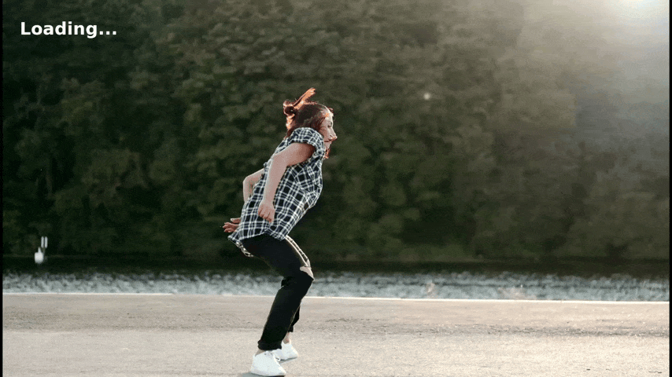
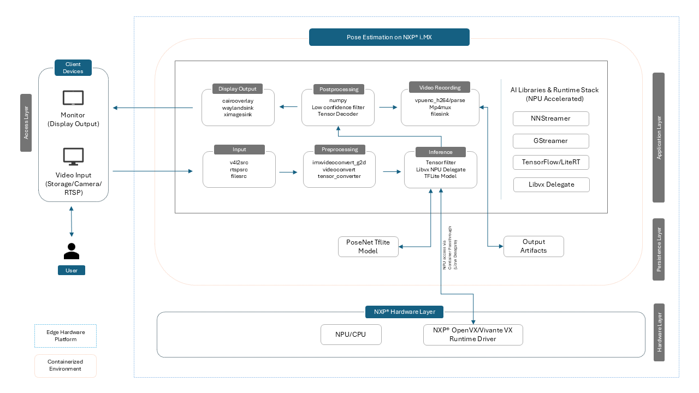

# Pose Estimation on NXP i.MX

**Version:** 1.0  
**Release Date:** Aug 2025  
**Copyright:** © 2025 Advantech Corporation. All rights reserved.

## Overview

The `Pose Estimation on NXP i.MX` container image provides a comprehensive environment for Pose Estimation model on NXP NPU-enabled hardware. This containerized setup ensures full hardware acceleration, reliability, and support for popular runtime environments like NNstreamer, and LiteRT. This container utilizes **Posenet** as the pose estimation model.

### Key Features

- **Complete AI Framework Stack:** NNstreamer, LiteRT
- **Edge AI Capabilities:** Optimized pipelines for real-time vision tasks (pose estimation)
- **Preconfigured Environment:** Comes with all necessary tools pre-installed in a container
- **Full NPU/GPU Acceleration:** Utilize NXP i.MX NPU and GPU for fast and efficient inference


## Quick Demonstration

Pose Estimation using Posenet-Resnet Model



## Architecture



## Hardware Specifications

| Component       | Specification      |
|-----------------|--------------------|
| Target Hardware | [Advantech EPC-R3720](https://www.advantech.com/en/products/880a61e5-3fed-41f3-bf53-8be2410c0f19/epc-r3720/mod_fde326be-b36e-4044-ba9a-28c4c49a25c6) |
| SoC             | [NXP i.MX8MPLUS](https://www.nxp.com/products/IMX8MPLUS?tab=Documentation_Tab)   |
| GPU             | Vivante GC7000UL       |
| NPU             | Vivante GC7000UL       |
| Memory          | 6 GB LPDDR4       |

## Operating System

| Environment        | Operating System                                    |
|--------------------|-----------------------------------------------------|
| **Device Host**    | Yocto (5.15-kirkstone)                              |
| **Container**      | Ubuntu:22.04                                        |


## Software Components

| Component   | Version | Description                                                                                  |
|-------------|---------|----------------------------------------------------------------------------------------------|
| LiteRT      | 2.9.1   | Provides TFLite Delegate support for GPU and NPU acceleration                            |
| GStreamer   | 1.20.0  | Multimedia framework for building flexible audio/video pipelines                             |
| NNStreamer   | 2.1.1 | NNStreamer is a pipeline-centric multimedia framework enabling flexible audio/video processing integrated with TFLite and other ML backends.                             |
| Python   | 3.10  | Python runtime for building applications                             |


## Supported AI Capabilities

### Vision Models

| Model                               | Format       | Note                                                                 |
|-------------------------------------|--------------|----------------------------------------------------------------------|
| PoseNet (ResNet50)              | TFLite       | Provide By NXP Demo Experience   |                                      
| MobileNet V1             | TFLite   | Provide By NXP Demo Experience                                       |
| SSD Mobilenet V2              | TFLite | Provide By NXP Demo Experience                                       |
| Facenet       | TFLite       | Provide By NXP Demo Experience                                      |


> **Note:** The above tables highlight a subset of commonly used models validated for this environment. Other transformer-based or vision models may also be supported depending on runtime compatibility and hardware resources. For the most detailed and updated list of supported models and runtimes, please refer to the NXP official [NXP Demo Experience](https://github.com/nxp-imx-support/nxp-demo-experience-assets/tree/lf-5.15.52_2.1.0/models).


## Supported AI Model Formats

| Runtime | Format  | Compatible Versions | 
|---------|---------|---------------------|
| LiteRT  | .tflite |       2.9.1        | 

## Hardware Acceleration Support

| Accelerator | Support Level | Compatible Libraries |
|-------------|---------------|----------------------|
| NPU         |  INT8 (primary), limited mixed precision, (INT16/FP16 → quantized internally)       | TensorFlow Lite (VX Delegate), NNStreamer  |             
| GPU         |  FP32 / FP16         | TensorFlow Lite (GPU delegate)    |             


### Precision Support

| Precision  | Support Level | Notes |
|------------|---------------|-------|
| FP32       | CPU, GPU      | Highest accuracy, slower performance |
| FP16      | NPU     | Not directly exposed via NPU |
| INT16       | NPU (internal mixed ops)     |Some operators quantized into 16-bit internally |
| INT8       | NPU,CPU      |Primary mode for NPU acceleration, best performance-per-watt |
## Repository Structure
```
Pose-Estimation-on-NXP-iMX/
├── .env                                      # Environment configuration
├── data                                      # ReadMe Data (images, gifs etc.)
├── advantech-model-download.sh               # Script to download model and artifacts files
├── README.md                                 # Container overview and quick start steps
├── windows-git-setup.md                      # Steps to fix LF/CRLF issues on windows while copying to device
├── build.sh                                  # Script to build the container
├── docker-compose.yml                        # Docker compose file
├── advantech-pose.py                         # Run  Pose Estimation inference pipeline
└── wise-bench.sh                             # Script to verify AI software stack inside the container
```
## Quick Start Guide

### Prerequisites
* Please ensure docker & docker compose are available and accessible on device host OS
* Since default eMMC boot provides only 16 GB storage which is in-sufficient to run/build the container image, it is required to boot the Host OS using a 32 GB (minimum) SD card.

### Clone the Repository (on your development machine)

> **Note for Windows Users:**  
> If you are using **Linux**, no changes are needed — LF line endings are used by default.  
> If you are on **Windows**, please follow the steps in [Windows Git Line Ending Setup](./windows-git-setup.md) before cloning to ensure scripts and configuration files work correctly on Device.

```bash
git clone https://github.com/Advantech-EdgeSync-Containers/Nagarro-Container-Project.git
cd Nagarro-Container-Project
```

### Transfer the `Pose-Estimation-on-NXP-iMX` Folder to EPC-R3720 Board

If you cloned the repo on a **separate development machine**, use `scp` to transfer only the relevant folder:

```bash
# From your development machine (Ubuntu or Windows PowerShell if SCP is installed)
scp -r .\Pose-Estimation-on-NXP-iMX\ <username>@<epcr3720-ip>:/home/<username>/
```

Replace:

* `<username>` – Login username on the EPC-R3720 board (e.g., `root`)
* `<epcr3720-ip>` – IP address of the EPC-R3720 board (e.g., `192.168.1.42`)

This will copy the folder to `/home/<username>/Pose-Estimation-on-NXP-iMX/`.

Then SSH into the board:

```bash
ssh <username>@<epcr3720-ip>  (add '-X' tag for X11 display)
cd ~/Pose-Estimation-on-NXP-iMX
```

### Installation

```bash
# Make the build script executable
chmod +x build.sh

# Launch the container
./build.sh
```

### Software Stack Verification (Optional)
```bash
# To Download model file and necessary files 
cd /workspace
chmod +x advantech-model-download.sh
./advantech-model-download.sh

# Software Stack Inside Docker Container
chmod +x wise-bench.sh
./wise-bench.sh
```


Wise-bench logs are saved in the `wise-bench.log` file under `/workspace`

### Download Model

```bash
# chmod +x advantech-model-download.sh  //executable permissions
#./advantech-model-download.sh         //download model file and necessary files
```

### Run Pose Estimation Pipeline (CLI)

> **Camera Setup Note:** If you want to run this container for camera feed, ensure the camera is connected to the edge device before running ./build.sh or starting the container. Verify camera detection using the following command:
```bash
v4l2-ctl --list-devices
```


Use the following command to run inference with your exported model:

```bash
 python3 advantech-pose.py [-h] [--video VIDEO] [--platform PLATFORM] [--backend {CPU,NPU}] [--model MODEL] [--labels LABELS] [--save-video {yes,no}][--display {X11,weston}] [--cam-width CAM_WIDTH] [--cam-height CAM_HEIGHT] [--cam-format CAM_FORMAT]
```

Here’s what each field represents:
* **`-h, --help`**
  Optional. Show help message with available options and exit.
* **`--video`**
  Optional (default: videos/pose_example.mov). Can be:
   * A video file (e.g., `videos/pose_example.mov`)
   * A discover option, if camera video format/resolution/path is not known (e.g., `discover`)
   * A live camera device (e.g., `/dev/video0`)
   * A RTSP stream (e.g., `rtsp://172.16.8.18:8550/video`)

* **`--cam-width`**
  Optional (default: `1920`). Applicable **only when `--source` is a webcam device**. Sets the webcam's capture width.

* **`--cam-height`**
  Optional (default: `1080`). Applicable **only when `--source` is a webcam device**. Sets the webcam's capture height.

* **`--backend`** Optional (default: CPU). Chooses the inference backend for running the ML model.
   * **`CPU`** → Runs inference on ARM Cortex-A cores
   * **`NPU`** → Runs inference on i.MX8MP’s NPU (Vivante) for best performance

* **`--model`** Path to the TFLite model file used for inference (e.g., posenet_resnet50_uint8_float32_quant.tflite).

* **`--labels`** File containing the labels or keypoint names corresponding to model outputs (e.g., key_point_labels.txt).

* **`--save-video`** Optional (default: no) Determines whether to save the annotated inference output as a video file.
   * **`yes`** → Save annotated output to disk
   * **`no`** → Only display live results

* **`--display`** Optional (default: weston). Chooses the display backend for live video visualization.
   * **`X11`** → Display output using X server (desktop environments with X)
   * **`weston`** → Display output using Wayland/Weston compositor, typically used on embedded Linux devices like i.MX8MP
* **`--cam-format`** Optional (default: BGRx). Specifies camera pixel format for video capture.

##### Example Commands
* **Run pose on a video file on CPU:**

  ```bash
  python3 advantech-pose.py --video videos/pose_example.mov
  ```

* **Run pose on a video file on NPU:**

  ```bash
  python3 advantech-pose.py --backend NPU --video videos/pose_example.mov
  ```
* **Run pose via discover (e.g. `discover`):**

  ```bash
  python3 advantech-pose.py --backend NPU --video discover
    ```
* **Run pose via webcam (e.g. `/dev/video0`):**

  ```bash
  python3 advantech-pose.py --backend NPU --video /dev/video0 --cam-width=1920 --cam-height=1080
  ```
* **Run pose via RTSP (e.g. `rtsp://172.16.8.18:8550/video`):**

  ```bash
  python3 advantech-pose.py --backend NPU --video rtsp://172.16.8.18:8550/video
  ```

* **Display on X11:**
  ```bash
  python3 advantech-pose.py --backend NPU --video videos/pose_example.mov --display X11
  ```
  Note: The output will be displayed on X11, and the video will not be saved.

* **Display and Save to MP4 File:**
  ```bash
  python3 advantech-pose.py --backend NPU --video videos/pose_example.mov --save-video yes
  ```
---

### Important Note: Format & Resolution Support

* This GStreamer-based Pose Estimation workflow supports MP4, MOV, Camera and RTSP input formats and is tested for 360p, 480p, 720p, and 1080p resolutions only. Other resolutions may lead to misaligned detection boxes and pose skeleton due to scaling and aspect ratio handling issues with the video sink.

## Recommendation

Pose estimation performance can vary with video characteristics. For videos with clear full-body visibility (e.g., outdoor dance, sports etc.), **Posenet-Resnet** often provides stable results with lower compute overhead. However, for more complex cases such as indoor yoga, low-light conditions, or poses with floor contact and occlusion, it is recommended to use higher-capacity models to achieve better accuracy and stability.
 

## Known Limitations
- **LiteRT delegate coverage:** Not all TFLite ops are supported by the NPU; unsupported layers fall back to CPU/GPU, reducing FPS.
- **Operator coverage gaps:** Advanced layers (attention, deformable conv, some postprocessing ops) are not supported on NPU. Custom handling is required.
- **Quantization trade-offs:** INT8 is mandatory for NPU, but aggressive quantization can degrade accuracy in detection/segmentation tasks.
- **Resource constraints:** Large models (transformers >100M params) won’t run in real-time or may not fit in memory. Stick to quantized tiny/small variants.
- **Version sensitivity:** BSP release defines supported NNStreamer + LiteRT versions. Using mismatched SDKs (e.g., newer TFLite) can break delegate acceleration.
- **Single Pose:** PoseNet (ResNet50) is a single-pose model — it detects and estimates keypoints for one person at a time.


## Not Included in This Repository

| Component                        | Reason / Note                                    |
| -------------------------------- | ------------------------------------------------ |
| Model and label files        | Must be download manually using provided scripts |

---

## Best Practices

* Prefer **INT8 quantized** models for NPU acceleration
* Ensure **fixed batch sizes** when converting models
* Use lower `GST_DEBUG` levels for stable multimedia handling
* Always validate exported models on-device after deployment

## Possible Use Cases

### 1. Fitness & Rehabilitation

- Real-time exercise feedback: AI observe and correct posture during workouts for form optimization and injury prevention.
- Physical therapy training: Monitor patient movement and progression during rehab, enabling remote guidance.

### 2. Sports Analytics

- Performance analysis: Track athlete movements to analyze techniques, optimize form, and reduce injury risks.

### 3. Animation, AR/VR & Gaming

- Markerless motion capture: Drive character animations and virtual avatars using live body pose data from cameras.
- Immersive gameplay: Enable gesture-based controls for a more engaging experience.

### 4. Healthcare & Assisted Living

- Postural monitoring: Detect poor ergonomics or risky body alignment in real time—useful for workplaces or elder care.
- Fall detection: Identify and respond to falls or sudden movements in assisted living scenarios.

### 5. Surveillance & Behavior Analysis

- Abnormal activity detection: Analyze body postures and gestures to flag suspicious behavior or loose safety compliance.

### 6. Human–Robot Interaction

- Gesture-driven control: Robots interpret user pose for intuitive interactions, like teleoperation or cooperative tasks.

### 7. Retail & AR Applications

- Virtual try-ons: Use pose detection to enhance virtual fitting rooms—simulate apparel on users in real time.
- Interaction tracking: Monitor customer postures and gestures to improve retail UX.

### 8. Human–Computer Interaction & Gesture Recognition

- Touchless interfaces: Enable users to control systems or express intent using body pose or gestures (e.g., in sign language applications).


© 2025 Advantech Corporation. All rights reserved.